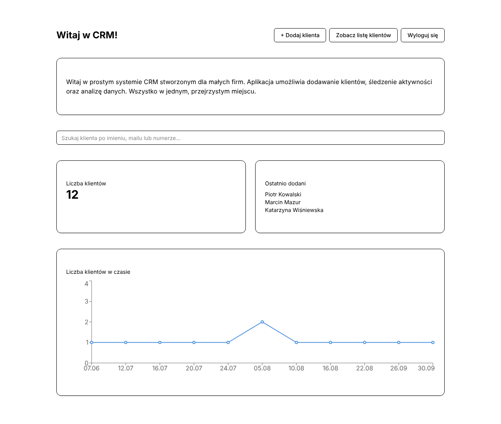
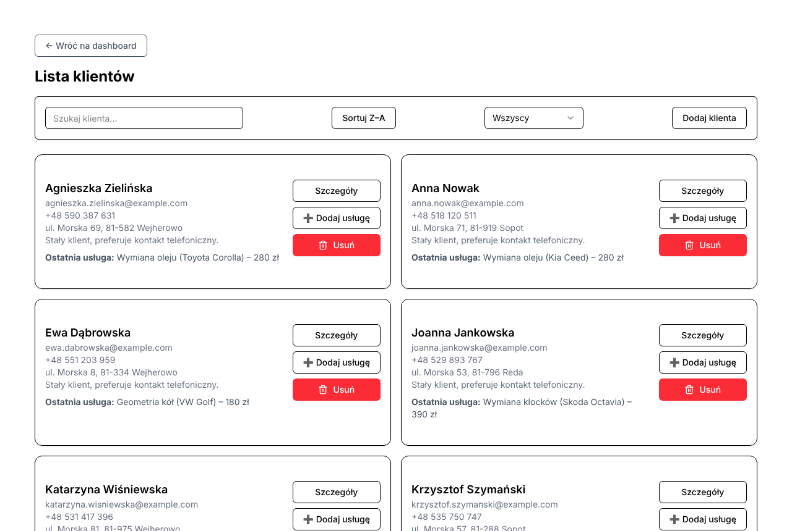
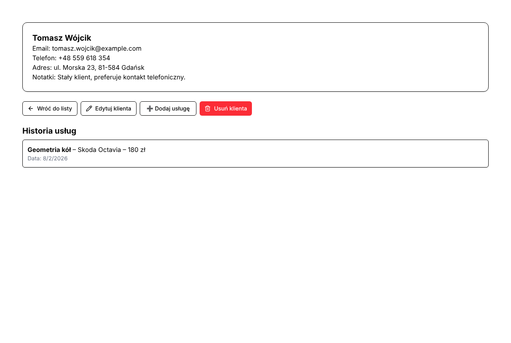
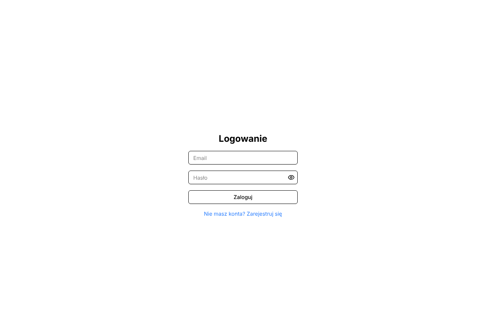
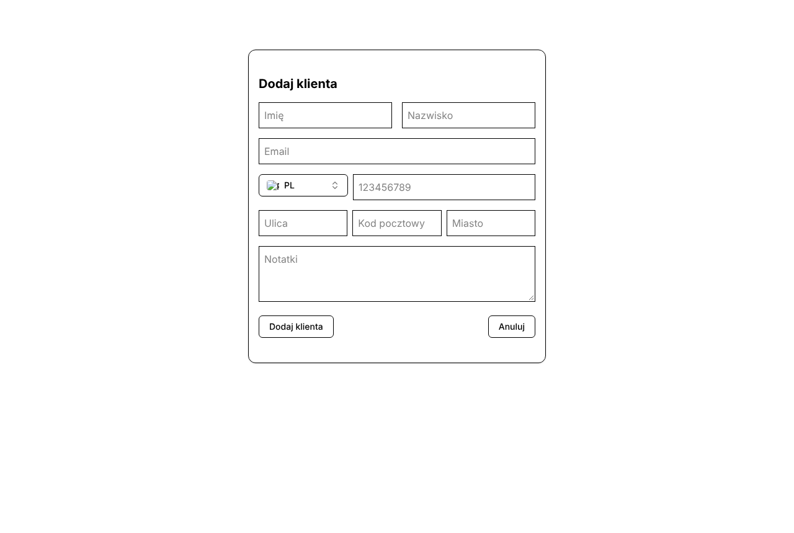

# CRM dla małych firm

Aplikacja webowa do zarządzania klientami i historią usług (np. dla warsztatu samochodowego). Pozwala dodawać i edytować klientów, przypisywać im usługi, wyszukiwać ich i śledzić przyrost bazy na wykresie.

> Projekt zespołowy zrealizowany w ramach studiów (Informatyka i Ekonometria, Uniwersytet Gdański). W tym repozytorium: **frontend**.



## Funkcje

- 🔐 Logowanie i rejestracja (JWT), automatyczne wylogowanie po bezczynności
- 👥 Lista klientów z wyszukiwarką, sortowaniem i filtrowaniem
- 📝 Dodawanie, edycja i usuwanie klientów
- 🔧 Historia usług klienta (usługa, model pojazdu, cena, data)
- 📈 Dashboard: liczba klientów, ostatnio dodani, wykres klientów w czasie

## Zrzuty ekranu

| Lista klientów | Szczegóły klienta |
|---|---|
|  |  |

| Logowanie | Nowy klient |
|---|---|
|  |  |

*Dane na zrzutach są fikcyjne.*

## Technologie

**React 19** · **TypeScript** · **Vite** · **Tailwind CSS** · **shadcn/ui (Radix UI)** · **React Router** · **Axios** · **Recharts** · **Framer Motion** · **Vitest + Testing Library**

Backend (osobny serwis): Node.js, Express, MongoDB (Mongoose), JWT, bcrypt.

## Struktura

```
src/
├── components/   # komponenty UI pogrupowane wg widoków
├── hooks/        # logika (useClientList, useClientSearch, useClientStats…)
├── lib/          # komunikacja z API i autoryzacja
├── pages/        # widoki: dashboard, lista, szczegóły, formularz, logowanie
├── routes/       # chronione trasy (PrivateRoute)
└── types/        # typy TypeScript
```

## Uruchomienie

```bash
npm install
cp .env.example .env      # ustaw VITE_API_URL na adres backendu
npm run dev               # http://localhost:5173
```

Inne komendy: `npm run build`, `npm test`, `npm run lint`.
